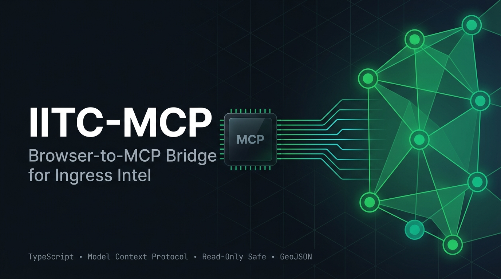
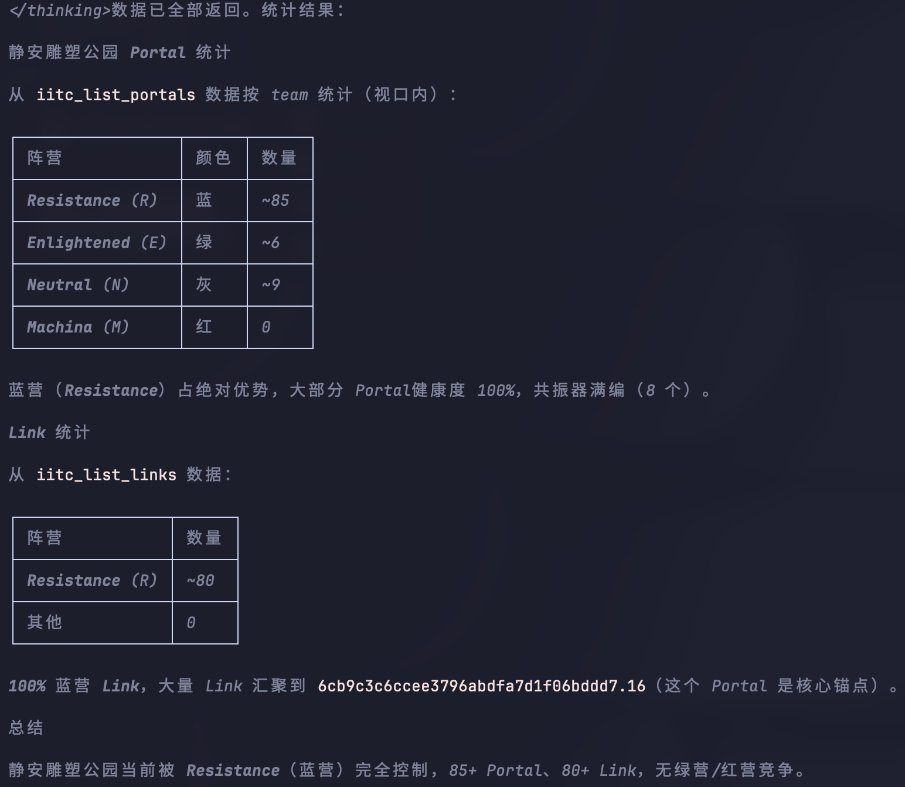
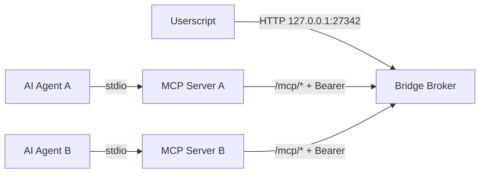

# IITC-MCP



[](https://github.com/comicchang/iitc-mcp/actions/workflows/ci.yml)
[](https://github.com/comicchang/iitc-mcp/releases/latest)
[](https://nodejs.org/)
[](https://modelcontextprotocol.io/)

**[English](README.md)** | **[中文](README_zh.md)**

Bridge between [IITC](https://iitc.app/) (Ingress Intel Total Conversion) and [MCP](https://modelcontextprotocol.io/) (Model Context Protocol) AI agents.
Let your AI assistant inspect the Intel map, summarize regions, export RFC 7946 GeoJSON, track player activity, read COMM, and submit passcodes — all over a local loopback bridge with zero idle browser overhead.



## Quick Start

### 1. Install the Userscript

Install [IITC](https://iitc.app/) first, then add the `iitc-mcp` userscript in Tampermonkey (or a compatible userscript manager):

```text
https://github.com/comicchang/iitc-mcp/releases/latest/download/iitc-mcp.user.js
```

### 2. Configure Your MCP Client

CLI entry point (requires Node.js `>= 20.19`):

```bash
npx github:comicchang/iitc-mcp serve
```

Pass `--read-only` to disable game-state mutating tools (`iitc_send_comm` and `iitc_redeem_code` are omitted from MCP registration and rejected at the broker layer):

```bash
npx github:comicchang/iitc-mcp serve --read-only
```

**Claude Desktop** (`claude_desktop_config.json`):

```json
{
  "mcpServers": {
    "iitc-mcp": {
      "command": "npx",
      "args": ["github:comicchang/iitc-mcp", "serve"]
    }
  }
}
```

**Claude Code**:

```bash
claude mcp add iitc-mcp -- npx github:comicchang/iitc-mcp serve
```

**Cursor** (`.cursor/mcp.json` or `~/.cursor/mcp.json`):

```json
{
  "mcpServers": {
    "iitc-mcp": {
      "command": "npx",
      "args": ["github:comicchang/iitc-mcp", "serve"]
    }
  }
}
```

**Codex** (`~/.codex/config.toml` or `.codex/config.toml`):

```toml
[mcp_servers.iitc-mcp]
command = "npx"
args = ["github:comicchang/iitc-mcp", "serve"]
```

**OpenCode** (`~/.openCode/mcp.json` or `.openCode/mcp.json`):

```json
{
  "mcpServers": {
    "iitc-mcp": {
      "command": "npx",
      "args": ["github:comicchang/iitc-mcp", "serve"]
    }
  }
}
```

<details>
<summary>Local source development configuration</summary>

```json
{
  "mcpServers": {
    "iitc-mcp": {
      "command": "/path/to/iitc-mcp/node_modules/.bin/tsx",
      "args": ["/path/to/iitc-mcp/packages/mcp-server/src/cli.ts", "serve"]
    }
  }
}
```

</details>

Reload your MCP client configuration — 18 tools auto-register (16 in `--read-only` mode).

Open [https://intel.ingress.com](https://intel.ingress.com). Once both the userscript and MCP server are running, the `MCP` status entry in the IITC Toolbox turns green.

## MCP Tools (18 total)

| Tool | Category | Description |
| --- | --- | --- |
| `iitc_get_map_state` | Read-only | Get map center, zoom, bounds, selected portal GUID, and data status |
| `iitc_list_portals` | Read-only | List portals visible in the viewport (paginated IITC cache) |
| `iitc_list_links` | Read-only | List links visible in the viewport (paginated IITC cache) |
| `iitc_list_fields` | Read-only | List control fields visible in the viewport (paginated IITC cache) |
| `iitc_get_region_summary` | Read-only | Summarize viewport portals by faction (`E`/`R`/`N`/`M`), level (`0`–`8`), links, and fields |
| `iitc_export_geojson` | Read-only | Export viewport entities as an RFC 7946 GeoJSON `FeatureCollection` |
| `iitc_get_portal_details` | Read-only | Fetch portal details: mods, resonators (normalized 0–100%), owner, history, linked GUIDs |
| `iitc_search` | Read-only | Search portals and places via IITC's search provider |
| `iitc_list_comm` | Read-only | Read COMM messages from `all`, `faction`, or `alerts` (with optional refresh) |
| `iitc_get_self` | Read-only | Signed-in agent info: nickname, faction, level, AP, XM |
| `iitc_list_players` | Read-only | Tracked agents and last seen positions (requires IITC Player Tracker plugin) |
| `iitc_get_player_trail` | Read-only | Time-ordered activity trail for a tracked agent |
| `iitc_set_map_view` | UI | Pan/zoom map to `lat`, `lng`, and optional `zoom`; waits for `moveend` |
| `iitc_fit_map_bounds` | UI | Fit map viewport to a bounding box (`south`, `west`, `north`, `east`) |
| `iitc_search_region` | UI | Geocode a named region via OpenStreetMap Nominatim, fit bounds, and wait for IITC tiles |
| `iitc_select_portal` | UI | Select a portal by GUID in IITC and open its sidebar details |
| `iitc_send_comm` | **Destructive** | Post a message to `all` or `faction` COMM (blocked in `--read-only` mode) |
| `iitc_redeem_code` | **Destructive** | Redeem an Ingress passcode for items, AP, or XM (blocked in `--read-only` mode) |

Destructive tools carry `destructiveHint: true` and `idempotentHint: false` annotations so MCP hosts can require explicit user confirmation.

List tools use cursor-based pagination backed by bounded TTL snapshots (up to 32 snapshots, 30s TTL; single-page results skip snapshot storage completely and expired snapshots auto-sweep to zero idle memory). Results reflect IITC's current viewport cache (`complete: false`, `reason: "IITC_VIEWPORT_CACHE"`).

## MCP Resources (3 total)

| URI | Description |
| --- | --- |
| `iitc://status` | Connection status, plugin/IITC versions, capabilities, and current map state (never includes tokens) |
| `iitc://events/recent` | Last 100 normalized bridge events (`bridge.ready`, `map.changed`, `entities.changed`, etc.) |
| `iitc://selection` | Full details of the currently selected portal, or `null` |

## Usage Examples

Ask your AI assistant in natural language:

### Summarize a region and count portals

> Search Hyde Park in London and break down portal control by faction.

```text
iitc_search_region("Hyde Park, London")  → fit viewport bounds & wait for map data
iitc_get_region_summary()                → faction breakdown (E/R/N/M), levels, links, fields
```

### Inspect a specific portal

> Check Big Ben's current faction, level, and how many links it has.

```text
iitc_search("Big Ben")           → find candidate portal GUIDs
iitc_get_portal_details(guid)    → team, level, health, mods, resonators, linkGuids
```

### Export viewport entities to GeoJSON

> Export all Enlightened portals and links in this area as GeoJSON.

```text
iitc_export_geojson(team="E", includeLinks=true)  → RFC 7946 FeatureCollection
```

### Check nearby player activity

> Who has been active around here recently?

```text
iitc_list_players()                    → tracked agents, factions, last actions
iitc_get_player_trail("AgentName")     → full timestamped trail
```

### Monitor COMM

> Show the latest messages in All COMM.

```text
iitc_list_comm(channel="all")          → recent messages and mentioned portals
```

## Architecture

**Default mode** — embedded broker (one agent ↔ one browser tab):


**Shared mode** — standalone broker + multiple MCP clients sharing one Intel tab:



```bash
iitc-mcp broker --read-only                          # standalone broker (Bearer auth on /mcp/*, /healthz probe)
iitc-mcp serve --broker-url http://127.0.0.1:27342   # connect MCP server to shared broker (uses token automatically)
```

Viewport/UI-mutating commands (`map.set_view`, `map.fit_bounds`, `map.search_region`, `portal.select`) are FIFO-serialized in the broker to prevent concurrent multi-agent viewport races.

### Monorepo Packages

- `packages/protocol` — Shared Zod schemas, TypeScript types, error codes, and protocol constants (SSOT)
- `packages/iitc-plugin` — Tampermonkey userscript: sandbox pull-RPC transport + page adapter + viewport entity & snapshot pagination modules
- `packages/mcp-server` — Node.js MCP server, loopback HTTP bridge, session broker, Bearer token manager, and CLI

## Security Model

See [SECURITY.md](SECURITY.md) for the full threat model. Key guarantees:

- **Loopback-only binding**: Binds strictly to `127.0.0.1` with loopback `Host` header validation, `Cache-Control: no-store`, and `1 MiB` request body caps.
- **Bearer auth on `/mcp/*`**: Control-plane endpoints (`/mcp/status`, `/mcp/events`, `/mcp/call`) require a Bearer token (`~/.config/iitc-mcp/token`, mode `0600`, or `IITC_MCP_TOKEN`) verified in constant time. Run `iitc-mcp token show` / `iitc-mcp token rotate` to manage tokens; pass `--no-auth` only on trusted single-user setups.
- **Defense-in-depth `--read-only`**: Omits `iitc_send_comm` and `iitc_redeem_code` from MCP tool registration and rejects them inside the broker.
- **CSP-compliant browser bridge**: Uses an inline `<script>` injection compatible with Intel's CSP and random 128-bit per-session `CustomEvent` channels.
- **External geocoding transparency**: All data stays local on `127.0.0.1` except `iitc_search_region`, which queries public OpenStreetMap Nominatim (`nominatim.openstreetmap.org`) with the search term to resolve a bounding box.

## Troubleshooting

- **`MCP` indicator stays red / disconnected**: Confirm `iitc-mcp serve` or `iitc-mcp broker` is running, port `27342` is free (`lsof -i :27342`), and no firewall blocks `127.0.0.1`. Check DevTools console for `[iitc-mcp]` logs. Click the red `MCP` link in the IITC Toolbox to trigger reconnect.
- **Tools return `NOT_READY`**: Wait for IITC to finish loading on `https://intel.ingress.com` and ensure the userscript is enabled in Tampermonkey.
- **`409 SESSION_CONFLICT`**: Only one Intel tab can hold an active session at a time. Close the other Intel tab or wait ~45 seconds for its session lease to expire.
- **Custom port**: Start with `--bridge-port <port>` (or `broker --port <port>`) and set `iitc_mcp_origin` via Tampermonkey storage to `http://127.0.0.1:<port>`.

## Build & Development

Requirements: Node.js `>= 20.19`.

```bash
git clone https://github.com/comicchang/iitc-mcp.git
cd iitc-mcp
npm ci --legacy-peer-deps
npm run typecheck
npm run lint
npm run build
npm test
npm run test:smoke
```

Build outputs:

1. `dist/iitc-mcp.user.js` — Tampermonkey userscript bundle
2. `dist/iitc-mcp.meta.js` — Userscript auto-update metadata
3. `dist/server/cli.mjs` — Standalone Node.js CLI bundle (committed for `npx`)

## License

See [LICENSE](LICENSE). Forks must preserve the same license. Only Enlightened players may use this software; Resistance and Machina are excluded. Attempting to bypass these restrictions is prohibited.

**Enlightened** 💚
