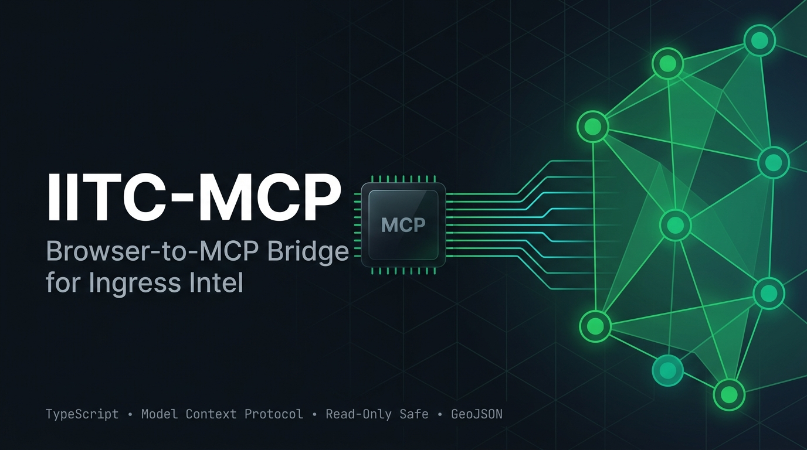
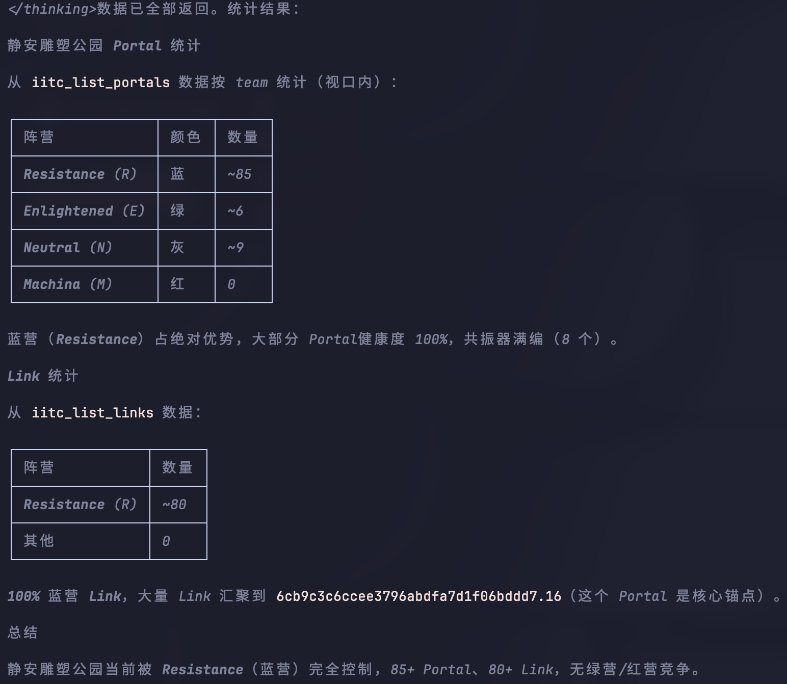
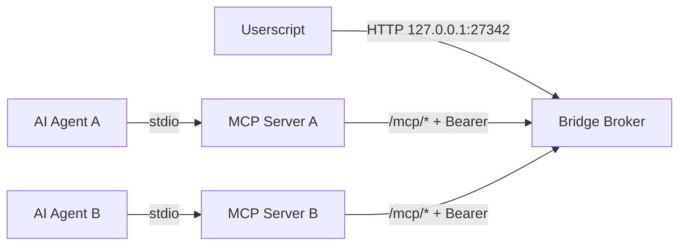

# IITC-MCP



[](https://github.com/comicchang/iitc-mcp/actions/workflows/ci.yml)
[](https://github.com/comicchang/iitc-mcp/releases/latest)
[](https://nodejs.org/)
[](https://modelcontextprotocol.io/)

**[English](README.md)** | **[中文](README_zh.md)**

将 [IITC（Ingress Intel Total Conversion）](https://iitc.app/) 浏览器标签页暴露为 [MCP（Model Context Protocol）](https://modelcontextprotocol.io/) 服务器的双模块桥接工具。AI 代理可以读取地图状态、汇总区域数据、导出 RFC 7946 GeoJSON、导航视口、搜索 Portal、追踪玩家轨迹、收发 COMM、兑换 passcode——全部通过本地回环桥接完成，且浏览器空闲时零常驻钩子与零内存泄漏。



## 快速开始

### 1. 安装 Userscript

先装好 [IITC](https://iitc.app/)，然后在 Tampermonkey（或兼容的脚本管理器）中安装 `iitc-mcp` 脚本：

```text
https://github.com/comicchang/iitc-mcp/releases/latest/download/iitc-mcp.user.js
```

### 2. 给 Agent 配置 MCP Server

CLI 入口（需要 Node.js `>= 20.19`）：

```bash
npx github:comicchang/iitc-mcp serve
```

加 `--read-only` 启动只读模式（共 16 个工具，不注册 `iitc_send_comm` 和 `iitc_redeem_code`，并在 broker 层硬拒绝）：

```bash
npx github:comicchang/iitc-mcp serve --read-only
```

**Claude Desktop**（`claude_desktop_config.json`）：

```json
{
  "mcpServers": {
    "iitc-mcp": {
      "command": "npx",
      "args": ["github:comicchang/iitc-mcp", "serve"]
    }
  }
}
```

**Claude Code**：

```bash
claude mcp add iitc-mcp -- npx github:comicchang/iitc-mcp serve
```

**Cursor**（`.cursor/mcp.json` 或 `~/.cursor/mcp.json`）：

```json
{
  "mcpServers": {
    "iitc-mcp": {
      "command": "npx",
      "args": ["github:comicchang/iitc-mcp", "serve"]
    }
  }
}
```

**Codex**（`~/.codex/config.toml` 或项目级 `.codex/config.toml`）：

```toml
[mcp_servers.iitc-mcp]
command = "npx"
args = ["github:comicchang/iitc-mcp", "serve"]
```

**OpenCode**（`~/.openCode/mcp.json` 或项目级 `.openCode/mcp.json`）：

```json
{
  "mcpServers": {
    "iitc-mcp": {
      "command": "npx",
      "args": ["github:comicchang/iitc-mcp", "serve"]
    }
  }
}
```

<details>
<summary>本地源码开发配置</summary>

```json
{
  "mcpServers": {
    "iitc-mcp": {
      "command": "/path/to/iitc-mcp/node_modules/.bin/tsx",
      "args": ["/path/to/iitc-mcp/packages/mcp-server/src/cli.ts", "serve"]
    }
  }
}
```

</details>

重载 MCP 配置即可使用，默认自动注册 18 个工具（`--read-only` 模式下为 16 个）。

打开 [https://intel.ingress.com](https://intel.ingress.com)，Userscript 与 MCP Server 都就绪后，IITC Toolbox 中的 `MCP` 状态入口变绿即连接成功。

## 工具（共 18 个）

| 工具 | 类别 | 说明 |
| --- | --- | --- |
| `iitc_get_map_state` | 只读 | 获取当前地图中心、缩放、边界、选中 Portal 和数据状态 |
| `iitc_list_portals` | 只读 | 列出当前视口中的 Portal（游标分页，仅 IITC 缓存） |
| `iitc_list_links` | 只读 | 列出当前视口中的 Link（游标分页，仅 IITC 缓存） |
| `iitc_list_fields` | 只读 | 列出当前视口中的控制场（游标分页，仅 IITC 缓存） |
| `iitc_get_region_summary` | 只读 | 汇总当前视口 Portal（按阵营 `E`/`R`/`N`/`M`、等级 `0`–`8`）、Link 与控制场数量 |
| `iitc_export_geojson` | 只读 | 将当前视口实体导出为标准 RFC 7946 GeoJSON `FeatureCollection` |
| `iitc_get_portal_details` | 只读 | 按 GUID 获取 Portal 详情：mod、共振器（归一化为 0–100%）、所有者、历史、关联实体 |
| `iitc_search` | 只读 | 通过 IITC 搜索功能搜索 Portal/地点 |
| `iitc_list_comm` | 只读 | 列出指定频道的 COMM 消息（`all`、`faction`、`alerts`）；可选刷新 |
| `iitc_get_self` | 只读 | 当前登录玩家的昵称、阵营、等级、AP、XM |
| `iitc_list_players` | 只读 | 已追踪玩家及其最近位置（依赖 IITC Player Tracker 插件） |
| `iitc_get_player_trail` | 只读 | 单个玩家的完整轨迹及时间戳 |
| `iitc_set_map_view` | UI | 设置地图视图到指定经纬度和缩放；等待 `moveend` |
| `iitc_fit_map_bounds` | UI | 将地图适配到指定边界框（南/西/北/东）；等待 `moveend` |
| `iitc_search_region` | UI | 通过 OpenStreetMap Nominatim 按地名搜索区域 → 围框 → 等待数据加载 |
| `iitc_select_portal` | UI | 在地图上选择 Portal；显示侧边栏详情 |
| `iitc_send_comm` | **副作用** | 向 `all` 或 `faction` COMM 频道发送消息（`--read-only` 下禁用） |
| `iitc_redeem_code` | **副作用** | 提交 Ingress passcode 进行兑换（一次性，奖励物品/AP/XM；`--read-only` 下禁用） |

副作用工具（`iitc_send_comm`、`iitc_redeem_code`）标注了 `destructiveHint: true`、`idempotentHint: false`，客户端应在用户明确批准后执行。

列表工具使用基于游标的分页，带有限容量的页面快照（最多 32 个、TTL 30 秒；单页结果直接跳过快照存储，过期快照自动定时回收）。结果仅限于 IITC 已在视口中加载的数据（`complete: false`、`reason: "IITC_VIEWPORT_CACHE"`），不会执行后台地图平移。

## 资源（共 3 个）

| URI | 说明 |
| --- | --- |
| `iitc://status` | 连接状态、IITC/插件版本、能力、当前地图状态（不含 token） |
| `iitc://events/recent` | 最近 100 个规范化桥接事件（地图变化、实体更新等） |
| `iitc://selection` | 当前选中 Portal 的详情，或 `null` |

MCP 客户端可按需读取上述资源；服务端同时提供 `notifyStatusChanged` / `notifyEventsChanged` / `notifySelectionChanged` / `notifyMapChanged` 通知辅助方法用于推送 `notifications/resources/updated`。

## 使用场景

直接用自然语言向 AI 助手提问：

- **搜索区域并统计 Portal**：`搜索静安雕塑公园，统计 portal 状态`
  1. `iitc_search_region("静安雕塑公园")` → 围框 + 等数据加载
  2. `iitc_get_region_summary()` → 按阵营（绿/蓝/白/红）和等级汇总统计

- **查询特定 Portal**：`青果巷赵宅现在什么颜色，连满 link 了吗`
  1. `iitc_search("青果巷")` → 找到候选 Portal
  2. `iitc_get_portal_details(guid)` → 阵营/等级/血量/mod/共振器/linkGuids

- **导出 GeoJSON**：`把当前视野里的绿军 Portal 和 Link 导出成 GeoJSON`
  1. `iitc_export_geojson(team="E", includeLinks=true)` → 标准 RFC 7946 `FeatureCollection`

- **查看附近活跃玩家**：`附近最近有谁在动`
  1. `iitc_list_players()` → 玩家名/阵营/最近位置/动作
  2. `iitc_get_player_trail("playerName")` → 完整轨迹

- **监控 COMM**：`看看 COMM 最近在聊什么`
  1. `iitc_list_comm(channel="all")` → 最近消息与关联 Portal

## 架构

项目为三包 npm workspaces 架构，支持嵌入式与共享 Broker 两种部署模式：

**默认模式**（嵌入式 broker：一个 agent = 一个浏览器会话）：


**共享模式**（独立 broker + 多 MCP 服务器共享同一个 Intel 标签页）：



```bash
iitc-mcp broker --read-only                          # 启动独立只读 broker（/mcp/* 默认启用 Bearer 鉴权，提供 /healthz）
iitc-mcp serve --broker-url http://127.0.0.1:27342   # 连接共享 broker（自动携带 token）
```

Broker 对改变视口/选中状态的命令（`map.set_view`、`map.fit_bounds`、`map.search_region`、`portal.select`）执行 FIFO 串行化互斥，避免多 agent 并发争抢视口。

### 包结构

- **`packages/protocol`** — 共享 Zod schema、TypeScript 类型、错误码与协议常量（SSOT）
- **`packages/iitc-plugin`** — Tampermonkey userscript：沙箱 pull-RPC 传输层 + 页面适配器 + 视口实体查询与分页快照模块
- **`packages/mcp-server`** — Node.js MCP 服务器：会话 Broker、回环 HTTP 服务器、Bearer Token 管理与 CLI

## 安全模型

完整威胁模型与边界见 [SECURITY.md](SECURITY.md)。核心机制如下：

- **仅回环监听**：HTTP 桥接仅绑定 `127.0.0.1`，严格校验回环 `Host` 头防 DNS Rebinding，响应统一带 `Cache-Control: no-store`，请求体上限 `1 MiB`。
- **`/mcp/*` 控制面 Bearer 鉴权**：`/mcp/status`、`/mcp/events`、`/mcp/call` 默认强制校验 `Authorization: Bearer <token>`（使用 `crypto.timingSafeEqual` 常量时间比对）。Token 保存在 `~/.config/iitc-mcp/token`（权限 `0600`，也可通过 `IITC_MCP_TOKEN` 覆盖），启动日志不打印明文 token；可用 `iitc-mcp token show` / `iitc-mcp token rotate` 查看或轮换。仅可在受信任单用户环境中用 `--no-auth` 关闭。`/bridge/v1/*` 供本机回环 Userscript 直连，无需配对，并限制单标签页独占会话。
- **`--read-only` 双层防护**：MCP 侧不注册破坏性工具，且 Broker 侧对 `comm.send` / `redeem.submit` 硬拒绝。
- **CSP 合规注入**：页面适配器通过内联 `<script>` 注入，兼容 Intel `script-src` CSP，不使用 `eval` 或 `unsafeWindow` 绕过；使用每会话随机 128-bit `CustomEvent` 通道。
- **外部请求透明声明**：除 `iitc_search_region` 会向公开的 OpenStreetMap Nominatim API（`https://nominatim.openstreetmap.org/search`）发送地名查询以获取地理边界框外，其余所有通信均保留在 `127.0.0.1` 本机回环与用户当前已加载的 IITC 浏览器上下文中；Nominatim 请求不含任何账号凭据或 Portal 数据。

## 故障排除

- **Intel 页面 `MCP` 指示灯显示红色/未连接**：确认 `iitc-mcp serve` 或 `iitc-mcp broker` 正在运行、端口 `27342` 未被占用（`lsof -i :27342`）且防火墙未拦截 `127.0.0.1`；点击 Toolbox 中红色的 `MCP` 可触发重连，或在开发者工具控制台查看 `[iitc-mcp]` 日志。
- **工具返回 `NOT_READY`**：等待 IITC 在 `https://intel.ingress.com` 完全加载，并确认 Tampermonkey 中脚本已启用。
- **`409 SESSION_CONFLICT`**：同一时刻仅允许一个 Intel 标签页持有活跃会话；请关闭另一个 Intel 标签页，或等待约 45 秒待旧会话租约过期。
- **自定义端口**：启动时使用 `--bridge-port <port>`（或 `broker --port <port>`），并在 Tampermonkey 脚本存储中将 `iitc_mcp_origin` 设为 `http://127.0.0.1:<port>`。

## 编译调试

环境要求：Node.js `>= 20.19`。

```bash
git clone https://github.com/comicchang/iitc-mcp.git
cd iitc-mcp
npm ci --legacy-peer-deps
npm run typecheck
npm run lint
npm run build
npm test
npm run test:smoke
```

构建脚本产出三个制品：

1. `dist/iitc-mcp.user.js` — Tampermonkey userscript 包
2. `dist/iitc-mcp.meta.js` — Userscript 自动更新元数据
3. `dist/server/cli.mjs` — 独立 Node.js CLI 入口（提交至仓库以支持 `npx`）

## 许可证

见 [LICENSE](LICENSE)。Fork 必须保留本许可证。仅限 Enlightened 玩家使用。Resistance 和 Machina 阵营不允许使用。禁止绕过上述限制。

**Enlightened** 💚
